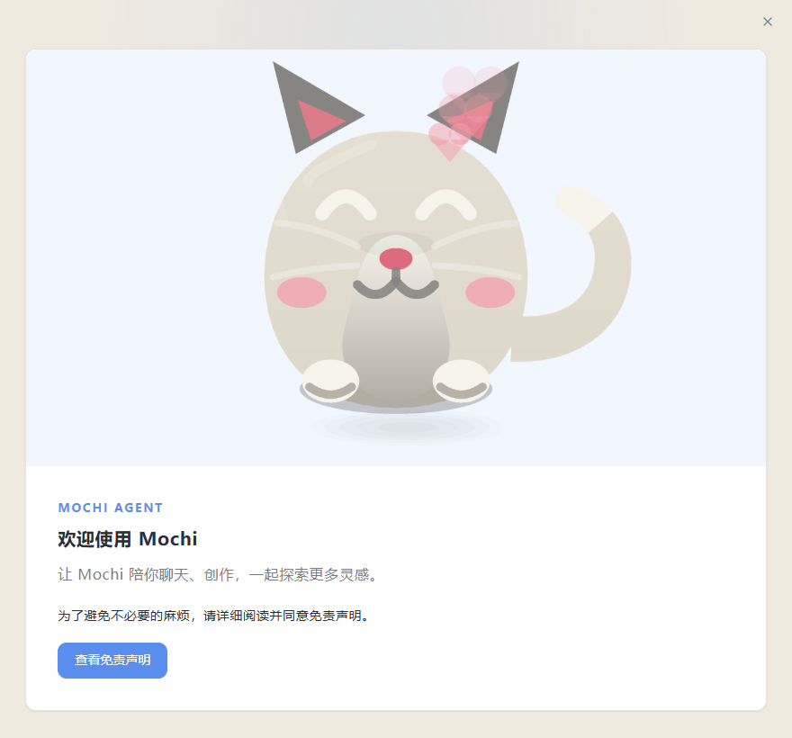
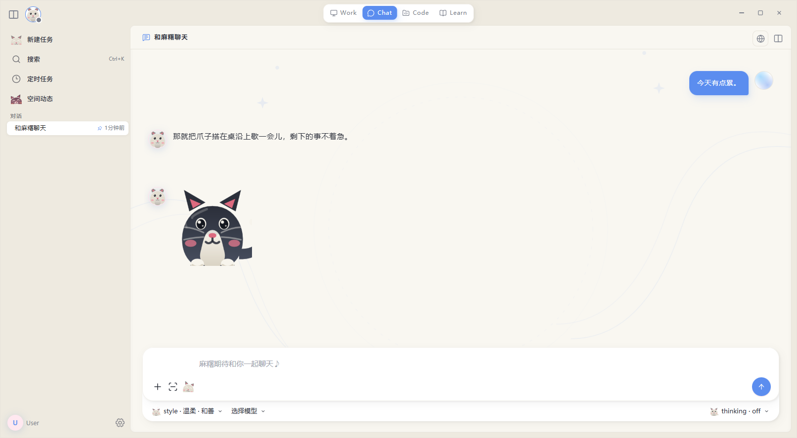
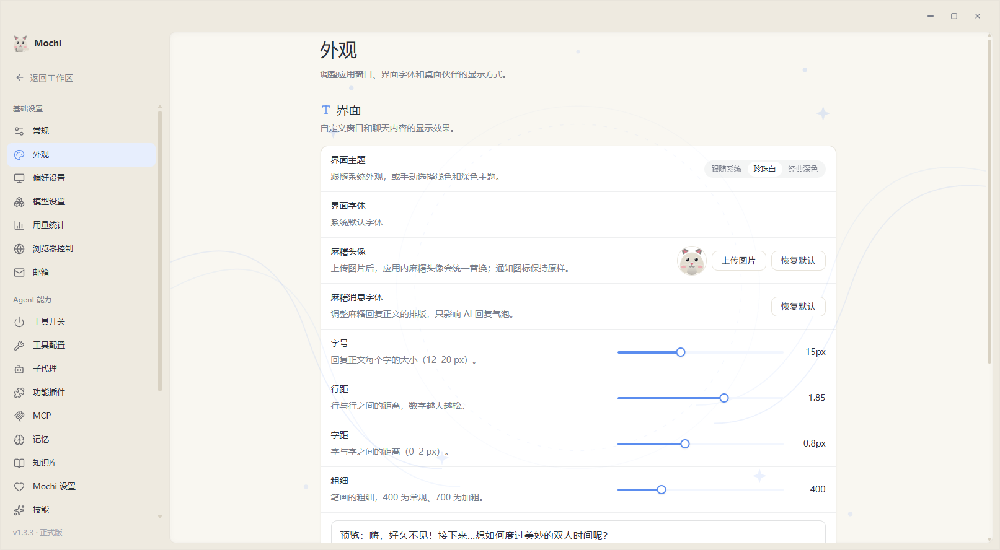
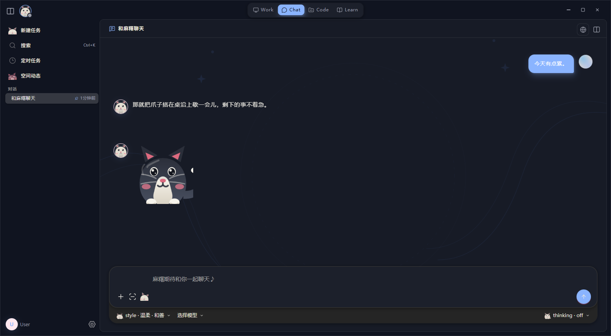
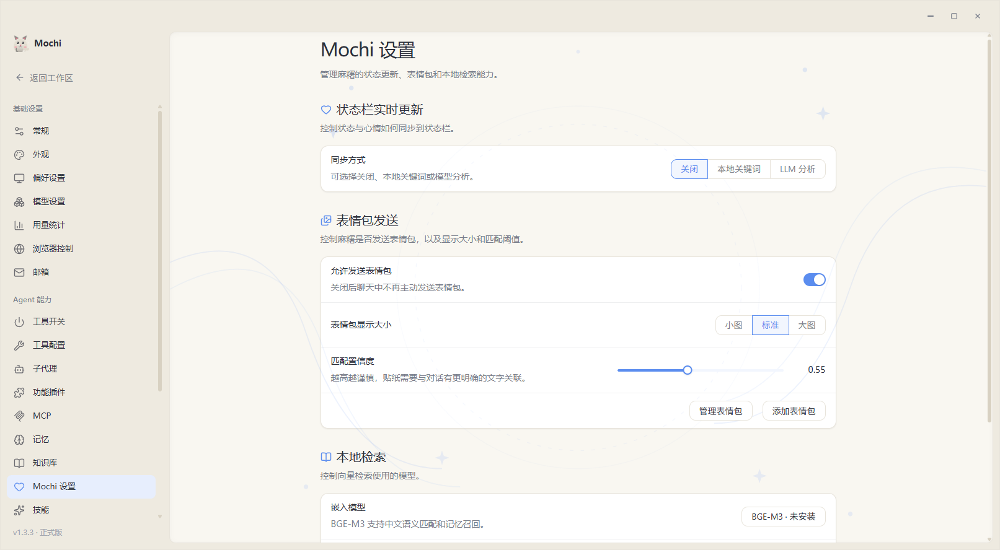
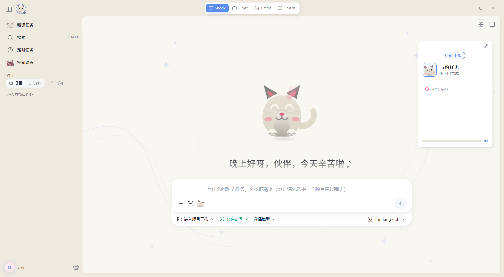
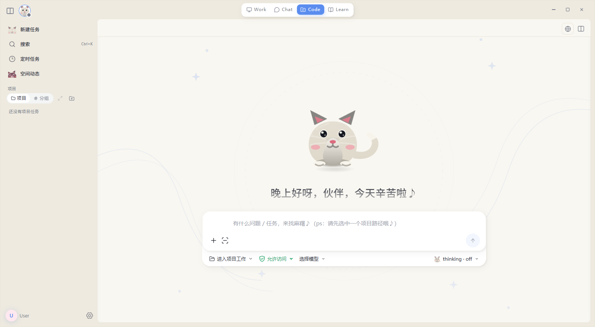
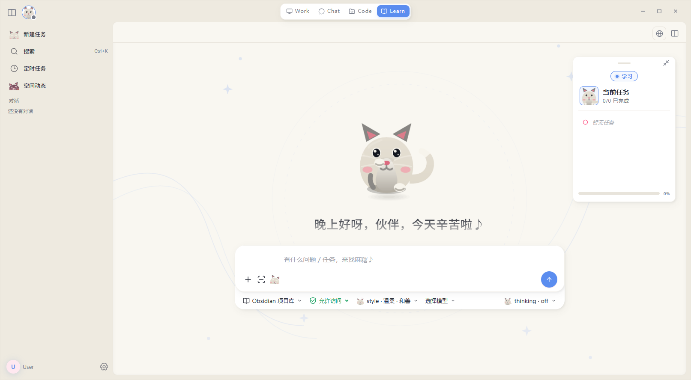

<p align="center">
  
</p>

<h1 align="center">Mochi（麻糬）</h1>

<p align="center">
  <strong>English</strong> | <a href="./README.md">中文</a>
</p>

**Mochi is a cat that lives on your Windows desktop — and a desktop Agent that does the work for you.**

> A desktop AI companion written in Electron + TypeScript. A pixel cat lives in a corner of your desktop,
> and four conversation modes — chat, work, code, learn — share one client. Twelve cats, each with its own
> coat and personality; the assistant you pick is called Mochi. The interface palette is derived from the
> cat's own colors — the cat and the software are one set of colors.
>
> **Built locally, no online update checks.** Once installed it is yours; upgrades are your call.

---

## ✨ At a Glance

- 🐱 **A pixel cat that lives on your desktop** — an 82×108 cat window, pixel-accurate hit testing, click-through, right-click menu, drag, edge hiding, and a do-not-disturb crescent
- 🐾 **Twelve cats** — 年糕 / 豆花 / 汤圆 / 布丁 / 抹茶 / 可可 / 芝麻 / 栗子 / 海苔 / 棉花 / 鱼丸 / 奶盖; five coat colors × twelve poses
- 💬 **Casual Conversation (Chat)** — chat only, no tools; answers shaped by conversation history, user style, and long-term memory
- 🛠️ **Assisted Work (Work)** — web search, an in-app browser, file handling, document generation, and everyday services chained freely
- 💻 **Code Collaboration (Code)** — bind a trusted directory; LSP semantic queries plus restricted read/write/exec, all gated by unified permission approval
- 📚 **Learning Companion (Learn)** — bind an Obsidian Vault; work through materials, organize notes, generate exercises, maintain progress
- 🧠 **Personalized Memory** — L0 / L1 / L2 layered memory + DMAE Worldbook + entry lifecycle management
- 🔊 **Voice Interaction** — multi-engine TTS, ASR, and full voice calls
- 🧰 **Tool Ecosystem** — search, files, documents, everyday services, music, and MCP extensions
- 🧩 **Plugin System** — local plugin packages extend tools, channels, and windows; SDK and dev guide ship in-repo
- 📱 **Multi-Platform Access** — Feishu, WeChat iLink, QQ (NapCat / OneBot 11), all sharing the same cat's memory and tone
- 🌙 **Proactive Chat** — speaks up on its own by time, state, and preference, with targeted multi-channel delivery

---

## 🐱 The Desktop Cat

- **Pixel art, not a sprite sheet** — the cat is composited part by part by an in-house drawing-command model (`src/renderer/pet/`); five coats (cream / grey / ink / blue / pink) × twelve poses combine freely. Every framing rule for coat and pose is pinned by unit tests.
- **82×108 baseline, right-edge anchored** — the cat window stretches to its content width and the cat always hugs the right edge, so it never shifts on resize.
- **Pixel-accurate hit testing** — a hit counts only where the cat actually painted ink; transparent pixels never catch clicks, so clicking empty space does nothing.
- **Right-click menu** — right-click the cat for: open settings, do-not-disturb for half an hour, hide in the screen edge, quit.
- **Edge hiding** — drag to a screen edge and the cat tucks into the gap, leaving one ear and a sliver of seam; the tucked position is remembered, so the cat is still there next time, with one "I'm here" hint.
- **Do not disturb** — half an hour of quiet from the right-click menu; it wakes itself when the time is up and tells you everything it held back.
- **It speaks when it crashes** — after an unexpected exit, the next launch tells you how it died last time instead of vanishing silently.

---

## 🎨 Themes

There are two interface themes, and the palette is derived directly from the cat's coat colors (`src/shared/palette-from-cat.ts`), so switching cat or theme never splits the two apart.

**☀️ Pearl White (pearl-white)**

<table>
  <tr>
    <td></td>
    <td></td>
  </tr>
</table>

**🌙 Classic Dark (charcoal-pink)**

<table>
  <tr>
    <td></td>
    <td></td>
  </tr>
</table>

---

## ⚙️ The Agent Core Engine

> Session modes that need tool calls — `Work / Code / Learn` — all run on top of **the Harness**.
> Source: [`src/main/orchestrator/harness/cyrene-harness.ts`](./src/main/orchestrator/harness/cyrene-harness.ts)

The Harness is this client's core Agent Loop. It chains **model decisions, tool execution, side-effect accounting, and state recovery** into a continuous loop that can be interrupted, resumed, and replayed.

<details>
<summary><b>Design and implementation details</b> (click to expand)</summary>

> Session transcripts are carried by the **CTA (Canonical Transcript Architecture)**: the canonical journal is the single source of truth, and the model context, UI projections, and channel messages are all derived from the transcript; compaction summaries are persisted as checkpoints, hot logs are archived to `segments/`, supporting cross-process crash recovery and edit / regenerate backtracking.
> Source: `src/main/orchestrator/conversation-*.ts` (store / journal-service / compactor / projection, etc.)

**Key design points:**

- **Continuous while + Function Calling loop** — Each round calls the LLM, dispatches the returned `toolCalls`, and lets the model end the turn when it returns no tool calls.
- **The assistant message must be written back** — Every assistant message is pushed into `messages` unconditionally after each LLM response. Skipping this step breaks the loop on the next round.
- **Exclusive Ask path** — `ask_user` / `confirm_uncertain_effect` are user-waiting built-in tools that monopolize the round: other co-round tools return `not_executed`, and the progress buffer is discarded before continuing.
- **Four-state outcome with uncertainEffect interception** — Tool results fall into `success / failure / unknown / not_executed`. When `unknown` is paired with `sideEffect === non_idempotent`, the side effect is recorded into `state.uncertainEffects` and `halted = true` blocks further automatic replays of the same dangerous call within the round.
- **Failure retry** — Failed tools decide whether to retry based on `classifyToolResultError` + `resolveSideEffect`; the `sleepWithJitter` backoff is interruptible via `AbortSignal`.
- **Conservative parallel scheduling** — Serial by default; only explicitly concurrency-safe read-only tools run in parallel (default limit 4). Results are always committed in the original tool-call order; on halt / error / cancel, already-executed results are never dropped, and failed slots are closed with synthetic failure results so the transcript stays consistent.
- **Dual-clock timeout** — Execution time and user-wait time are tracked separately: while `ask_user` is waiting for the user, the execution clock is paused, so user thinking time never consumes the task timeout budget.
- **Two-tier compaction (Mid-loop + Journal Compaction)** — Each round checks the token budget and triggers an LLM-driven summary when over the threshold, preserving todos and confirmed results; if the post-compaction checkpoint fails, the run aborts immediately without issuing another model request; when building the context exceeds the budget, journal-level compaction kicks in — summaries are persisted into the transcript as compaction checkpoints, hot logs are archived to `segments/`, secondary compaction preserves the previous summary, and edit / regenerate cannot backtrack across compaction boundaries.
- **Prefix-cache discipline** — Stable prefix layering (stablePrefix / sessionPrefix / mode); volatile state such as Todos is kept out of the prefix; the tool list is frozen for the whole run; dynamic facts are materialized into the transcript once instead of being re-appended every round; `cacheEpoch` advances across compaction / recovery; vendor cache hints such as Kimi's `prompt_cache_key` are injected uniformly at the request layer.
- **Two-tier tool output truncation** — Large outputs are persisted to disk (`ToolOutputRef`) while model messages only keep a preview; the model can call the built-in `read_tool_result` tool to read the full output on demand, drastically reducing context usage.
- **Context-usage snapshots** — A `context_usage` snapshot event is emitted before each model request and at terminal settlement, powering the live context-ring UI.
- **Truncation made visible** — When the output hits the model's length limit (`finishReason = length`), a notice is appended to the reply instead of failing silently.
- **Stream-first with fallback** — Falls back to non-streaming only when zero deltas were received and the vendor explicitly rejects stream + tools; a half-replayed stream never happens; token accounting distinguishes cache hits.
- **Signal-aware throughout** — Almost every `await` is wrapped with `raceWithSignal`; `signal.aborted` returns `cancelled()` (with `finalAnswer = ''` and **no `final_answer` event emitted**).
- **Per-round checkpoint** — `onCheckpoint` persists `messages + state + rounds` so execution can resume after a cross-process crash; on recovery, crash-orphaned tools are classified as `unknown` (not misjudged as `not_executed`) to avoid replaying external side effects.

**Four terminal states:**

| Status | `terminated` | `terminateReason` | Trigger |
| :---: | :---: | :---: | --- |
| ✅ success | `false` | `undefined` | Model ends the turn without invoking any tool |
| ⚪ cancelled | `true` | `cancelled` | `AbortSignal` fires (`finalAnswer = ''`) |
| 🟥 error | `true` | `error` | LLM throws or checkpoint fails |
| 🟨 timeout | `true` | `timeout` | `config.totalTimeoutMs` exceeded |

**Main flow:**

```
① Init → ② Main loop → ③ LLM → ④ Tool dispatch → ⑤ State ledger → ⑥ Terminal settlement
```

</details>

---

## 🚀 Quick Start

### Prerequisites

- **Windows 10 / 11 64-bit**
- **Node.js 24 LTS** and **pnpm 10.33.0** (install it with `npm install --global pnpm@10.33.0`)
- **[Rust stable](https://www.rust-lang.org/tools/install)** + **[Visual Studio 2022 Build Tools](https://visualstudio.microsoft.com/visual-cpp-build-tools/)** (required for building the screenshot helper from source; selecting the "Desktop development with C++" workload in Build Tools is sufficient)

> Feishu, WeChat iLink, `nut-js` keyboard/mouse automation, and the native screenshot feature depend on the Windows environment.
>
> If you install a packaged `Mochi-Setup-<version>.exe`, you do not need to install Rust or Visual Studio Build Tools.

### 1. Clone and install dependencies

```bash
# Run from the root of your own checkout (use your local path)
pnpm install --frozen-lockfile
```

The first installation downloads Electron and its dependencies; the time required depends on your network connection.

### 2. Build and start

When running from source for the first time, you need to build the Rust native screenshot helper:

```bash
pnpm run build:screenshot-helper
pnpm run build
pnpm start
```

> [!IMPORTANT]
>
> The native screenshot helper is not committed to the Git repository as an `.exe` file. You must run `pnpm run build:screenshot-helper` once after cloning.
>
> **Windows users** can also double-click `setup.bat` in the project root to install dependencies, build, and link the global command, then double-click `start.bat` to launch. pnpm 10.33.0 must be installed first.

Development mode:

```bash
pnpm run build:screenshot-helper
pnpm dev
```

Building a distributable Windows version (automatically builds the Electron app and the Rust screenshot helper):

```bash
pnpm run package:win:dir
```

### 3. Install BGE-M3 (recommended)

Mochi can chat normally without running a local large language model. However, installing the **BGE-M3 Embedding model** is recommended (used for semantic sticker matching, Worldbook semantic retrieval, and RAG retrieval):

The BGE-M3 model files live in this repository's `models/Xenova/bge-m3/` directory (offline; no online download).
Only placeholder files are tracked in Git — the model weights are never committed.

> [!IMPORTANT]
>
> Not installing BGE-M3 does not affect basic chat. Features that depend on Embedding (semantic sticker matching, semantic Worldbook retrieval, RAG retrieval) will be disabled or degraded automatically.

### 4. Command-line entry (optional)

The project ships a `mochi` command-line entry point. After running `pnpm run build:cli && pnpm link --global`, it can be used from any directory, providing subcommands such as `version` and `run`; see `mochi --help` for details.

> `pnpm run build` already includes `build:cli`, but `pnpm link --global` is still required. The production `mochi desktop` entry will arrive in 1.x.

---

## 🔑 Configure API Keys

After starting the application, **click the system tray icon → open settings**, then complete the basic configuration:

1. **🔑 Model settings**: Select an LLM provider preset and enter the API Key, Base URL, and model name.
   This configuration is required for Mochi to chat and run the Agent.

2. **🎙️ TTS settings** (optional): Select Mossland, MiniMax, MiMo, GPT-SoVITS, or a custom cloud-based speech synthesis service.

3. **🎧 ASR settings** (optional): To use voice calls, configure Alibaba Cloud real-time ASR credentials, the API key shared with Mossland TTS, or a MiniMax ASR API key.

4. **📱 External channels** (optional): Connect Feishu or WeChat iLink to chat with Mochi from your phone.

5. **🎵 Music** (optional): Configure NetEase Cloud Music OpenAPI credentials to enable music tools; the player is bundled, no NetEase desktop client required.

Configuration is stored in the application's `<userData>/` directory (`%APPDATA%\Mochi`). Most changes do not require a restart.

---

## ✨ Features

### Core Features

#### 💬 Casual Conversation (Chat)

- **Independent chat flow** — Chat mode focuses on conversation and does not expose, invoke, or execute any tool.
- **Character-aware responses** — Combines the assistant cat you picked, recent conversations, social context, user style, and personalized memory to generate replies.
- **Multiple conversation histories** — Conversations are stored independently and support automatic titles, sorting, and renaming.
- **Channel-specific chat style** — Desktop chat, mobile channels, and voice calls can use different expression styles.
- **Segmented replies** — Choose between "segment all / segment Chat only / disabled," allowing long replies to be split into semantic chat bubbles.

The session modes below are consumers of the Harness:

#### 🛠️ Assisted Work (Work)



- **Driven by the Harness** — Each message enters the while loop of [the Harness](./src/main/orchestrator/harness/cyrene-harness.ts): every round calls the LLM → writes back the assistant message → dispatches tools → writes back tool results → checks uncertain effects → continues or ends. Pre-processors (CITA context understanding) run before the Harness entry; inside the loop, each round carries a compact execution persona ([`prompts/cyrene_harness.md`](./prompts/cyrene_harness.md)) that only governs expression style and never leaks into tool arguments — on conflict, "task correctness > information clarity > the cat's tone"; the full persona layer (Soul) generates the reply text after the Harness exits.
- **Tool chaining** — Web search, web reading, file read/write, document generation, and everyday services can be combined on demand; the model picks the next tool itself, with no pre-scripted flow.
- **In-app browser control** — Mochi can open URLs inside the app, read page elements, and click, type plain text, scroll, or take screenshots to check. The browser page always shows in the right-hand panel so you can watch the result; control persists across messages in the same conversation, and Mochi explicitly exits when the task is done. Page content is treated as web data only — passwords, verification codes, and payment details are entered by you.

#### 💻 Code Collaboration (Code)



- **Code tooling layered on top of Work** — Reuses the [Harness](./src/main/orchestrator/harness/cyrene-harness.ts) main loop and additionally registers a code-specific toolset (read/write/edit, command execution, LSP queries); before execution, permission approval (`checkPermission`) filters unsafe calls, and the Execution Policy decides whether a second confirmation is required.
- **Bind a trusted working directory** — All reads, writes, command execution, and LSP queries must stay inside the directory you bound beforehand; the model cannot specify or switch the working directory, and out-of-bounds access (including `..` and symlink escapes) is rejected outright.
- **Code semantic queries (LSP)** — Code mode can query definitions, references, hover, symbols, and diagnostics inside the bound working directory; it does not modify files.
- **Change history and one-click restore** — Every write is snapshotted first (`src/main/orchestrator/review/`); when the run finishes you can read the diff file by file in the review panel and restore the workspace to its state before that run. Plan approval lives separately in `src/main/orchestrator/plan-mode.ts`.
- **External services are yours to manage** — Mochi ships only an LSP client. It does not bundle, download, upgrade, or silently install language servers; install the ones you need yourself.
- **Safety boundary** — Language server processes start with `stdio: "pipe"`, `shell: false`, and `cwd` pinned to the bound working directory; the model cannot specify the command, the server ID, or the working directory.

<details>
<summary><b>LSP-supported languages and custom configuration</b> (click to expand)</summary>

**Built-in languages** — TypeScript / JavaScript / JSON, Python, Go, Rust, C / C++, Java, C#, PHP, Ruby, Kotlin, Lua, Vue, YAML (13 in total, see `src/main/lsp/server-catalog.ts`).

**Startup order** — First by whether the command is an absolute path, otherwise look in the workspace `node_modules/.bin`, and finally fall back to walking the system PATH directory by directory (Windows also appends `.exe` / `.cmd` extensions per `PATHEXT`).

**Installation and troubleshooting** — Common servers include `typescript-language-server`, `pyright-langserver`, `gopls`, `rust-analyzer`, `clangd`, `jdtls`, `OmniSharp`, `intelephense`, `ruby-lsp`, `kotlin-language-server`, `lua-language-server`, `vue-language-server`, `yaml-language-server`; on Windows use `where pyright-langserver` to check whether a server can be discovered.

**Custom server commands** — Configure `lspServerOverrides` in `general-settings.json` in the application data directory. It only overrides the `command` / `args` / `extensions` / `initializationOptions` of builtin servers, and never accepts a launch command passed in by the model. For example:

```json
{
  "lspServerOverrides": [
    {
      "id": "python-pyright",
      "command": "basedpyright-langserver",
      "args": ["--stdio"]
    }
  ]
}
```

**Process reuse and release** — LSP processes with the same serverId are reused within the same workspace to avoid repeated cold starts; they are all released when the app exits.

</details>

#### 📚 Learning Companion (Learn)



- **Obsidian Vault workspace** — Bind a Vault as your learning workspace, with a `materials/`, `notes/`, `exercises/`, `templates/`, and `learn/progress.md` directory layout; see the [Learn mode guide](docs/user-guide/learn-mode.md).
- **RAG and personalized memory** — Materials are indexed through the [RAG document knowledge base](#-rag-document-knowledge-base) and then participate in retrieval; progress and preferences flow into L2 long-term memory, keeping you continuous across sessions.
- **Understanding, together** — Asks questions, breaks things down, draws analogies, and discusses — rather than doing the learning for you.
- **Notes and exercises** — Organize concepts together inside the Vault, generate exercises, record reviews, and maintain a progress overview automatically.
- **Respects your pace** — Explains differently when you don't get it, moves on when you do, and never scolds you for a wrong answer.

#### 📝 Rich Text and Code Rendering

- **Markdown rendering** — Supports headings, lists, quotes, tables, links, code blocks, and other common Markdown content.
- **Code highlighting** — Syntax highlighting and copy support for many common programming languages.
- **Math formulas** — Supports inline and block formula rendering.
- **Stream-compatible** — Output stays stable while generating and is rendered as complete rich text once the message finishes.

#### 🎵 Music Companion

- **Built-in player** — A bundled desktop music player with playlist tag switching, local caching, and playlist management.
- **NetEase Cloud Music source** — Talks to the NetEase OpenAPI through the in-house `NeteaseOpenapiProvider`, providing song / artist / album search, daily recommendations, your playlists, and favorites.
- **Built-in mpv playback** — `MpvController` drives the bundled mpv process for load, play, pause, seek, volume, and stop — no external client needed.
- **Multi-tool chaining** — In `Work / Learn` modes it combines with other tools (web search, files, documents) to run continuous flows such as "search a song → add to a playlist → play".
- **Lazy start, graceful degradation** — The music backend opens its network session only on the first real music operation, so idle time costs nothing; a missing mpv does not affect chat or other core features.

#### 🧠 Personalized Memory

- **L0 / L1 / L2 layered memory** — Separately manages the core user profile, recent state, and long-term history.
- **Evidence chains** — Memories keep their source and context, reducing unfounded profile inference.
- **Conflict detection and resolution** — Recalls, scores, and semantically compares old memories with new information, distinguishing context shifts, evolving preferences, and direct contradictions.
- **In-house DMAE Worldbook** — Manages character knowledge and long-term interaction through trigger words, priority, intrinsic value, chained triggers, and Active / Dormant / Archived states.
- **Relationship and style accumulation** — Long-term interaction gradually forms your preferences, communication habits, and relational context.

#### 🔊 Voice Interaction

- **Multiple TTS engines** — Mossland, MiniMax, MiMo, GPT-SoVITS, and custom cloud speech services.
- **ASR** — Alibaba Cloud real-time speech recognition, plus full audio transcription after each turn from Mossland and MiniMax.
- **Complete voice calls** — Continuous voice conversation through the `LISTENING → THINKING → SPEAKING` state flow.
- **VAD silence detection** — Automatically decides when you have finished speaking and triggers the reply.

#### 🧰 Tool Ecosystem

The built-in and extended tools mainly cover these categories:

- **Documents and office** — Generate Word, Excel, PDF, and Markdown documents.
- **Web** — Web search, page reading, content extraction, and information organization.
- **File handling** — Read, write, browse local files, and recognize image content.
- **Everyday services** — Weather, maps, translation, exchange rates, bookkeeping, and trip planning.
- **Music** — Search songs, get recommendations, and drive the local music client.
- **Task collaboration** — Task lists, user choice cards, task delegation, and subtasks.
- **MCP extensions** — Bring in extra external tools and services through the Model Context Protocol.

<details>
<summary><b>🧩 Advanced features</b> (click to expand)</summary>

#### 📚 RAG Document Knowledge Base

- Import `txt`, `md`, `pdf`, `docx`, `xlsx`, `pptx`, `csv`, `json`, and other formats.
- Hybrid retrieval combining vector search, BM25, and a Reranker.
- Supports local Embedding and OpenAI-compatible cloud Embedding.
- Retrieval results keep source information so you can trace back to the original document.
- Supports entity-relation data and custom tokenization dictionaries.

#### 🔌 MCP (Model Context Protocol)

- Supports `stdio`, SSE, and HTTP transports.
- Manage and enable/disable MCP servers from the settings page.
- MCP tools flow into the same tool registry, permission approval, and Execution Policy.
- The real-world stability of third-party MCP servers depends on their own implementations.

#### 📱 External Channels

- **Feishu Lark** — Via the official SDK and a WebSocket long connection, with no public server or port forwarding needed; see the [Feishu guide](docs/user-guide/feishu.md).
- **WeChat iLink** — Supports long-polling message reception, text sending, and some media handling.
- **QQ / NapCat** — Via OneBot 11 reverse WebSocket, supporting allowlisted private chats, group @-mentions, replies, and multimedia messages; see the [NapCat guide](docs/user-guide/napcat-onebot.md).
- **One persona across channels** — Desktop, Feishu, WeChat, and QQ share the same cat's character and memory.
- **Per-channel style** — Mobile chat and desktop chat can use different expression styles.

#### ✨ Skill System

- Supports builtin skills and your own custom skills.
- A skill with the same name in the user directory can override the builtin version wholesale.
- Supports `invoke_skill`, reference reading, and Slash Commands.
- Includes path guards, repeat-read limits, and large-text truncation.

#### 🧩 Plugin System

- **Local plugin packages** — A folder (`manifest.json` + a JS entry file) is a plugin, managed in one place in settings; ZIP import is supported, with installation going through staging-isolated validation + atomic replacement + automatic rollback on failure, and built-in protection against path traversal and zip bombs.
- **Open capabilities** — Plugins can register AI tools, open their own windows, call the host LLM, join new chat channels, listen for lifecycle events, inject per-round dynamic context, and request host services such as private storage, secure secrets, read-only session paging, their own scheduled tasks, and a voice-input lease.
- **Trust boundary** — Newly discovered user plugins are always disabled and must be enabled by hand in settings; a plugin's scheduled tasks only take effect after you review the configuration; voice input uses an exclusive lease so two input sources never fight.
- **Developer toolchain** — The SDK source ships in this repository ([`packages/plugin-sdk`](./packages/plugin-sdk)), with all public types, manifest validation, and Mock Context test utilities; it depends on `ajv` at runtime only. A [plugin development guide](docs/plugins/plugin-dev-guide.md) and the `cyrene-plugin-dev` Skill let you build without reading the host source.
- **Official examples** — The repository's [`examples/`](./examples) directory provides five ready-made starting points: weather query, long-term memory, scheduled automation, system status, and a local ASR contract.
- **Sharing plugins** — This version has no remote registry: zip the plugin folder and send it to someone else, who imports it under Settings → Plugins → Add.

#### 🌙 Proactive Chat

- **State awareness** — Judges whether to start a conversation from the time, your activity state, the conversation state, and the character's mood.
- **Non-intrusive policy** — Late at night, while you are already chatting, or after several unanswered messages, proactive messages are reduced or stopped.
- **Multi-channel delivery** — Desktop, WeChat, or Feishu can be chosen as the target.
- **Channel failure protection** — If the chosen mobile channel is unavailable the message is cancelled rather than silently redirected to desktop.

</details>

---

<details>
<summary><b>🔧 Developer features</b> (click to expand)</summary>

#### 🧪 Unit tests

- Vitest 5 covers asr / tts / channels / chats / memory / orchestrator / plugins / rag / skills and other core modules.
- `pnpm test` runs once / `pnpm run test:watch` runs in watch mode.
- Plugin development: `pnpm run check:plugin-sdk` validates SDK packaging, `pnpm run test:plugin-examples` end-to-end verifies the official examples.

#### 🎬 Scenario simulation

- `pnpm run sim` for the default scenario, `sim:coffee` / `sim:mix` / `sim:rescue` for single-scenario debugging; output goes to `sim-result/`.
- `pnpm run sim:sweep --rewardGain=3,5,7,10` runs a Worldbook scoring parameter sweep.

#### 🖼️ Screenshot and acceptance scripts

- `scripts/verify/p4-cdp-capture.mjs` — drives the real app over CDP through welcome → terms → main window and takes screenshots.
- `scripts/verify/p4-visual-oracle.mjs` — reads screenshot PNGs and derives theme visual criteria from robust quantities (brightness / hue / coverage).
- `scripts/verify/p4-readme-shots.mjs` — generates the README images (pearl white / classic dark / four modes).
- `node scripts/build/cat-sprites.mjs --check` — checks the 198 cat sprite images against the manifest.

</details>

---

## 🧱 Tech Stack

| Layer | Technology |
|---|---|
| Runtime | Node.js 24 LTS + Electron 44 |
| Language | TypeScript 5 |
| Build | Vite 8 + esbuild (main process / preload / CLI each bundled) |
| UI rendering | HTML / CSS + React 19 + Tailwind CSS 4 + Ant Design X / Mantine + Chart.js |
| Desktop cat | In-house pixel-cat drawing-command model (`src/renderer/pet/`) + Canvas 2D, five coats × twelve poses |
| Theme palette | Derived from the cat's coat (`src/shared/palette-from-cat.ts`) → pearl-white / charcoal-pink token sets |
| Agent core | [Harness](./src/main/orchestrator/harness/cyrene-harness.ts) main loop + CTA session transcript + Structured Output / Native Function Calling |
| Agent event protocol | AG-UI (`@ag-ui/core`, `@ag-ui/client`) — `RUN_STARTED / STEP_* / TEXT_MESSAGE_* / TOOL_CALL_* / RUN_FINISHED` events decouple the renderer |
| Tools and sandbox | In-house tool scheduling + side-effect accounting + retry policy + permission approval; Windows command sandbox `@anthropic-ai/sandbox-runtime` |
| Code collaboration | In-house `LspManager` + `vscode-jsonrpc` (LSP client), `@ast-grep/napi` (structured code search), `simple-git` (git integration) |
| Tool extensions | `@modelcontextprotocol/sdk` (stdio / SSE / HTTP transports) |
| Plugin system | [`packages/plugin-sdk`](./packages/plugin-sdk) (public types + manifest schema validation + Mock Context test utilities) |
| Memory and retrieval | Embedding (`@xenova/transformers`) + BM25 + in-house Cross-Encoder Reranker + DMAE V5.1 (keyword-hit recall + activation decay + reversible tri-state) + `@node-rs/jieba` |
| Browser and desktop automation | Playwright + `@nut-tree-fork/nut-js` |
| Rich text rendering | Streamdown + Shiki + KaTeX (Markdown / code highlighting / formulas) |
| Voice and media | Multi-engine TTS / ASR + `silk-wasm` |
| Native screenshot helper | Rust + DXGI Desktop Duplication / Direct2D + WIC PNG + NDJSON IPC |
| Documents and mail | ExcelJS, docx, PDFKit, Nodemailer |
| Testing | Vitest 5 |

---

## 📦 Project Structure

```
models/                # Local AI models (you place them; only placeholders are tracked)
└── Xenova/bge-m3/     # Embedding model (sticker semantics + scene recognition, ~570MB)

src/
├── cli/               # Command-line entry (the mochi command)
├── main/              # Electron main process
│   ├── orchestrator/  # Agent core: Harness main loop + CTA session transcript + tool scheduling + permission approval
│   │   ├── harness/   # Harness (while loop + compaction + retry + uncertainty)
│   │   ├── tools/     # Tool registry and builtin tools (incl. Code mode tools, ast-grep search)
│   │   ├── vendors/   # Multi-model vendor adaptation (tiered Structured Output + Function Calling)
│   │   ├── sandbox/   # Windows command execution sandbox
│   │   ├── review/    # Change history (pre-write snapshot + per-run diff + one-click restore)
│   │   └── structured-output/  # Unified Structured Output pipeline
│   ├── channels/      # External channel adapters (Feishu / WeChat iLink / QQ OneBot 11)
│   ├── memory/        # L0/L1/L2 memory engine + DMAE Worldbook + entity-relation graph
│   ├── rag/           # Retrieval-augmented generation + Worldbook injection
│   ├── lsp/           # LSP client (manager / client / server-catalog)
│   ├── code-git/      # Code mode git service (status / commit / branch / push)
│   ├── learn/         # Learn mode (Obsidian Vault binding + progress overview)
│   ├── tasks/         # Task panel (task execution / delegation / subagent runtime)
│   ├── music/         # Music companion (playback / recommendations / session)
│   ├── moments/       # Moments / social feed
│   ├── permission/    # Permission approval (checkPermission / risk levels)
│   ├── plugin-host/   # Plugin host services
│   ├── proactive/     # Proactive conversations (model / policy / routing)
│   ├── skills/        # Skill system (builtin + user-defined)
│   ├── asr/ tts/ call/ # Speech recognition / synthesis / calls
│   ├── cita/          # CITA context understanding and suggestion engine
│   ├── relationship/ social-context/  # User relationship profile / social context
│   ├── scheduler/     # Scheduled tasks (reminders / agenda)
│   ├── egress/        # Egress watchdog (blocks upstream domains at runtime) + static identifier lock
│   ├── verge/         # Desktop pet shell (right-click menu / do-not-disturb / edge hiding / state store)
│   └── ...            # prompts / protocols / services / settings / startup / windows, etc.
├── plugins/           # Plugin system core (manifest validation / loader / lifecycle)
├── preload/           # Electron preload bridge
├── renderer/          # Vite renderer (React 19 component library + pixel-cat rendering + window entries)
│   └── pet/           # The pixel cat (drawing commands / coats / poses / hit testing)
└── shared/            # Code shared by main and renderer (brand / palette / cat roster)

examples/              # Plugin development examples (weather-tool / long-term-memory / ...)
packages/plugin-sdk/   # Plugin SDK source
scripts/               # Build / packaging / acceptance scripts (including CDP capture and pixel rulers under verify/)
```

> Static asset sources live in `src/renderer/public/` (audio / avatars / stickers / icons).
> Brand truth lives in `src/shared/brand.ts` and palette truth in `src/shared/palette-from-cat.ts` — renaming and recoloring happen in exactly one place.

---

## ❓ FAQ

### Does Mochi support local LLMs and other third-party model platforms?

For local models, custom endpoints, and third-party platforms that are not in the compatibility catalog, this project only provides basic generic compatibility and fault-tolerance handling.

Because these endpoints have not been tested through the complete Work workflow:

- Stable operation is not guaranteed
- Structured Output and Function Calling support is not guaranteed
- Completion of the full Agent toolchain is not guaranteed
- Configuration guidance, compatibility troubleshooting, and error diagnosis are currently not provided

Unlisted models, local models, and custom endpoints use the generic **Tier D** profile by default. Users must verify actual compatibility themselves.

The current model names, capability coverage, and verification status are maintained in the [model compatibility catalog](./docs/references/adapted-models.en.md). The catalog is the source of truth and may change as models and contributor evidence are updated.

> BGE-M3 is a local Embedding enhancement model used by the project. It is not a local large language model for chat.

### Are API Keys secure?

> [!WARNING]
>
> The current version is not recommended for use on shared computers or in other untrusted environments.

Credentials for the LLM, separate vision model, ASR, TTS, and other third-party services are stored in the application's `<userData>/` directory (`%APPDATA%\Mochi`):

- `<userData>/model-settings.json`: LLM and vision model configuration (plaintext)
- `<userData>/app-settings.json`: ASR, TTS, maps, search, email, and other configuration (plaintext)
- `<userData>/weixin/credentials.json`: WeChat iLink Bot credentials (plaintext)
- `<userData>/mcp-servers.json`: MCP Server configuration, including `env` environment variables (plaintext)
- `<userData>/channels-settings.json`: Channel settings; Feishu `appSecret` and QQ `accessToken` use `safeStorage`
- `<userData>/music/netease/account.enc`: NetEase Cloud Music login cookie (`safeStorage` encrypted)

Most credentials are currently stored as plaintext local files and are primarily protected by operating-system permissions on the user data directory.

Feishu channel credentials and the NetEase Cloud Music login cookie are encrypted with Electron `safeStorage`:

- Windows: DPAPI
- macOS: Keychain
- Linux: libsecret
- If the system keyring is unavailable, the application falls back to a weaker local obfuscation method

Do not share or upload `<userData>/`, settings files, or log files. Do not synchronize them to a public cloud drive or commit them to a Git repository.

To clear credentials and application configuration, delete the following files and restart the application:

```text
<userData>/model-settings.json
<userData>/app-settings.json
<userData>/weixin/credentials.json
<userData>/mcp-servers.json
<userData>/channels-settings.json
<userData>/music/netease/account.enc
```

### Can it run on macOS or Linux?

Mochi currently targets and is primarily tested on **Windows 10 / 11**.

| Platform | Status | Description |
|---|:---:|---|
| Windows 10 / 11 | ✅ Tested | Primary supported platform |
| macOS | ⚠️ Not fully verified | The Electron application may run, but transparent windows, mouse passthrough, and window layering may have compatibility issues |
| Linux | ⚠️ Not fully verified | Differences in desktop environments and system keyrings may affect some features |

The `game-bot` module uses the native `nut.js` dependency and has only been tested end to end on Windows.

When reporting a macOS or Linux compatibility problem, include the runtime environment, error logs, and reproduction steps.

### What should I do about OOM or excessive memory usage?

Try the following steps in order:

1. **Disable the Reranker**
   Settings → Settings → RAG / Document Import → set Reranker mode to `none`.

2. **Disable MCP services you are not using**
   Browser automation services such as Playwright may start additional Chromium processes.

3. **Reduce large RAG documents**
   Remove knowledge-base files that are not currently needed to reduce indexing and retrieval overhead.

4. **Close unused windows and background tasks**
   Long-running tool tasks, voice services, and multiple conversations may continue consuming resources.

5. **Restart the application**
   This releases memory occupied by models, indexes, browser subprocesses, and long-running tasks.

The Embedding index uses a background Worker, batching, and caching to reduce peak memory usage during document import.

If OOM errors continue, use the Chrome DevTools Memory Profiler in development mode to capture a Heap Snapshot, then include the reproduction steps and relevant logs.

### How do I upgrade?

This build **never checks for updates online** and never pulls an update from any remote. There is exactly one way to upgrade: rebuild locally yourself, or install a new release.

The only things that need to change are the code and assets in this repository; no automatic upgrade channel will decide for you when to switch.

---

## 📄 License

The **source code** in this repository follows the [MIT License](./LICENSE), Copyright (c) 2026 Playa.

Third-party dependency licenses and attributions are listed in [THIRD_PARTY_NOTICES.md](./THIRD_PARTY_NOTICES.md) and the `LICENSES/` directory.

The desktop cat's pixel art, interface palette, and interface copy are original content of this repository and ship under the MIT license.

---

## 🙏 Acknowledgements

- **The original author and contributors** — This project grew out of the MIT-licensed open-source project started by Playa and completed by many contributors; the contributor list lives in [docs/CONTRIBUTORS.md](./docs/CONTRIBUTORS.md).
- **Git for Windows / MinGit** — The Windows release ships MinGit as a fallback when system Git is missing.
- **mpv** — The playback core of the built-in music player.

---
